# ⚒️ CodeForge AI

### Autonomous Software Engineering Agent

> **CodeForge doesn't just write code. It proves its work.**

CodeForge AI is an autonomous software-engineering agent designed to understand real codebases, reason about developer requirements, modify code, run tests, diagnose failures, repair them iteratively, and verify the final result before delivering changes through GitHub.

---

## ✦ The Idea

```text
USER TASK
    │
    ▼
UNDERSTAND
    │
    ▼
EXPLORE REPOSITORY
    │
    ▼
PLAN
    │
    ▼
MODIFY
    │
    ▼
TEST
    │
    ├──────── PASS ────────► VERIFY
    │                         │
    │                         ▼
    │                    GIT + GITHUB
    │                         │
    │                         ▼
    │                       PR
    │                         │
    │                         ▼
    │                    VERIFIED ✓
    │
    └──────── FAIL ────────► DIAGNOSE
                              │
                              ▼
                            REPAIR
                              │
                              └──────► TEST AGAIN
```

## 🚀 Why CodeForge?

Most AI coding tools focus on generating code.

**CodeForge focuses on engineering outcomes.**

| Principle | What CodeForge does |
|---|---|
| 🧠 Reason | Understands the task and repository before editing |
| 🔎 Explore | Finds relevant files, modules, tests and dependencies |
| 🛠️ Act | Uses controlled tools to modify the codebase |
| 🧪 Test | Runs real tests instead of assuming correctness |
| 🔧 Repair | Diagnoses and fixes failures iteratively |
| 🔍 Prove | Produces evidence that the implementation works |
| 🚀 Deliver | Creates a branch, commit and Pull Request |

---

# 🧭 Core Workflow

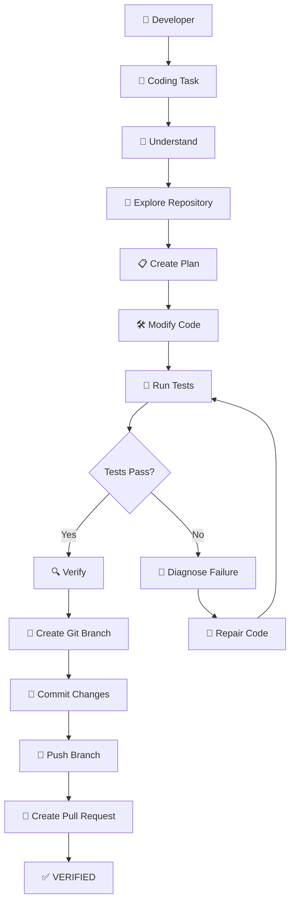

---

# 🏗️ System Architecture

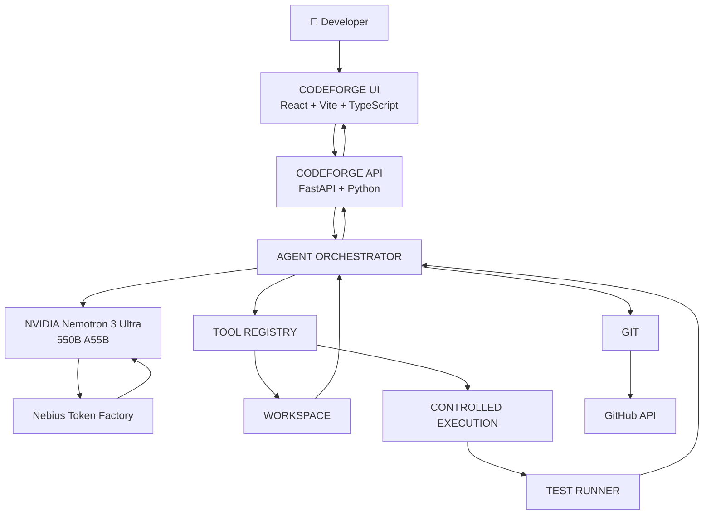

---

# 🧠 Agent Architecture

CodeForge separates **reasoning** from **execution**.

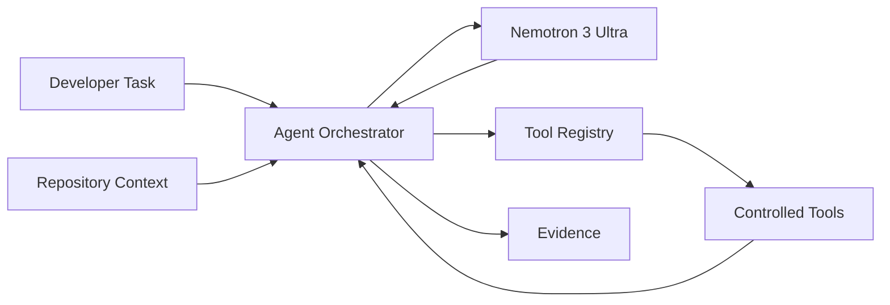

### Agent responsibilities

```text
AGENT
│
├── Task Understanding
├── Repository Exploration
├── Context Selection
├── Planning
├── Tool Selection
├── Code Modification
├── Test Execution
├── Failure Diagnosis
├── Autonomous Repair
├── Verification
└── Git Delivery
```

---

# 🛠️ Tool Architecture

```text
TOOL REGISTRY
│
├── Repository Tools
│   ├── list_files
│   ├── read_file
│   └── search_code
│
├── Modification Tools
│   ├── apply_patch
│   ├── write_file
│   └── inspect_diff
│
├── Testing Tools
│   └── run_tests
│
├── Git Tools
│   ├── git_diff
│   ├── git_branch
│   ├── git_commit
│   └── git_push
│
└── GitHub Tools
    └── create_pull_request
```

---

# 🔧 Autonomous Repair Loop

The defining capability of CodeForge is the:

**TEST → DIAGNOSE → REPAIR → VERIFY**

loop.

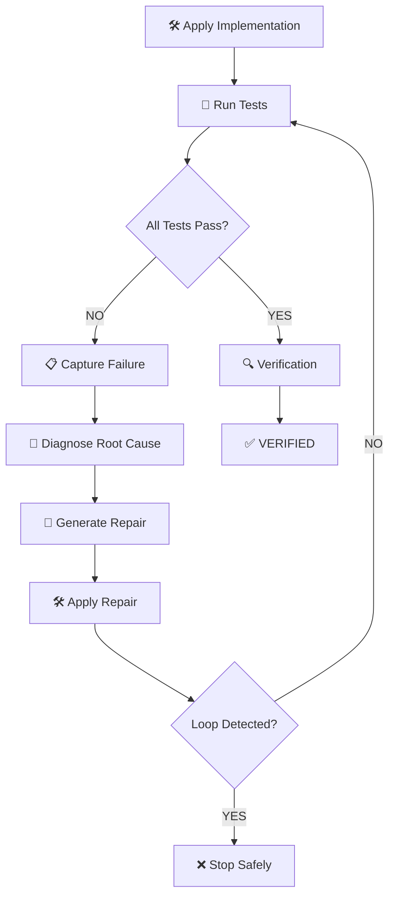

### Example

```text
Initial implementation
        │
        ▼
27 passed / 2 failed
        │
        ▼
Diagnose
        │
        ▼
Root cause identified
        │
        ▼
Repair #1
        │
        ▼
31 passed / 0 failed
        │
        ▼
VERIFY
        │
        ▼
VERIFIED ✓
```

---

# 🔀 GitHub Workflow

CodeForge is designed around a safe Git workflow.

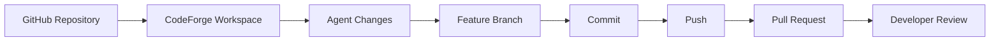

### Default philosophy

```text
❌ Agent → main

Instead:

Agent
  ↓
feature/codeforge/<task>
  ↓
commit
  ↓
push
  ↓
Pull Request
  ↓
Developer Review
```

---

# 📊 Feature Status

> Keep this table synchronized with the actual repository. Do not mark unfinished functionality as complete.

| Feature | Status |
|---|---|
| React + Vite frontend | ✅ Available |
| FastAPI backend | ✅ Available |
| Nemotron 3 Ultra integration | ✅ Available |
| Nebius Token Factory integration | ✅ Available |
| Repository exploration | ✅ Available |
| `list_files` | ✅ Available |
| `read_file` | ✅ Available |
| `search_code` | ✅ Available |
| Workspace path security | ✅ Available |
| Agent state management | ✅ Available |
| Structured agent events | ✅ Available |
| Code modification | 🔄 In Development |
| `apply_patch` | 🔄 In Development |
| Diff inspection | 🔄 In Development |
| Test execution | 🔄 In Development |
| Autonomous repair | 🔄 In Development |
| Final verification | 🔄 In Development |
| Git branch automation | 🔜 Planned |
| Git commit automation | 🔜 Planned |
| GitHub integration | 🔜 Planned |
| Pull Request creation | 🔜 Planned |
| Authentication | 🔜 Planned |
| Supabase persistence | 🔜 Planned |
| Prompt Score | 🔜 Planned |
| Prompt Improvement | 🔜 Planned |
| Token estimation | 🔜 Planned |
| Token usage analytics | 🔜 Planned |
| Agent efficiency | 🔜 Planned |
| Repository architecture map | 🔜 Planned |
| Dark / Light mode | 🔜 Planned |

---

# 🗺️ Product Roadmap

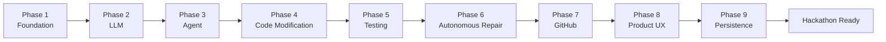

---

# 🖥️ Dashboard Architecture

CodeForge is designed as a developer workspace rather than a generic AI chatbot.

```text
CODEFORGE AI
│
├── WORKSPACE
│   ├── Repository
│   ├── Files
│   ├── Agent
│   ├── Changes
│   ├── Tests
│   └── Architecture
│
├── INSIGHTS
│   ├── Prompt Lab
│   ├── Usage
│   └── Efficiency
│
└── SETTINGS
    ├── Account
    ├── GitHub
    ├── Model
    ├── Theme
    └── Security
```

---

# 🎨 Main Workspace

```text
┌───────────────────────────────────────────────────────────────┐
│ CODEFORGE AI      repo / branch      STATUS     NEMOTRON     │
├──────────────┬────────────────────────────────────────────────┤
│              │                                                │
│ WORKSPACE    │              AGENT WORKSPACE                   │
│              │                                                │
│ Repository   │       WHAT SHOULD I CHANGE?                   │
│ Files        │                                                │
│ Agent        │       Describe your coding task.               │
│ Changes      │                                                │
│ Tests        │       ┌────────────────────────────────────┐   │
│ Architecture │       │                                    │   │
│              │       │ Task description                   │   │
│ INSIGHTS     │       │                                    │   │
│              │       └────────────────────────────────────┘   │
│ Prompt Lab   │                                                │
│ Usage        │                 RUN AGENT                      │
│ Efficiency   │                                                │
│              │                                                │
└──────────────┴────────────────────────────────────────────────┘
```

---

# ✍️ Prompt Intelligence

CodeForge is designed to help developers write better engineering tasks.

## Prompt Score

```text
PROMPT QUALITY
│
├── Clarity
├── Specificity
├── Context
├── Constraints
├── Testability
└── Token Efficiency
```

Example:

```text
PROMPT SCORE

82 / 100

✓ Clear objective
✓ Relevant context
✓ Test requirement included
△ Missing edge cases
△ Could specify affected modules
```

> Prompt Score is a quality estimate, not a guarantee of agent success.

---

# 🪄 Prompt Improvement

Example transformation:

```text
Before:

"add authentication"
```

```text
After:

Implement JWT-based authentication for the existing
login flow.

Requirements:
- Preserve current login behavior.
- Add access and refresh tokens.
- Protect authenticated API routes.
- Store secrets through environment variables.
- Add authentication middleware.
- Add unit and integration tests.
- Do not expose credentials.
- Keep the existing API contract unchanged.
```

---

# 🪙 Token Intelligence

CodeForge distinguishes between **estimated** and **actual** usage.

### Before execution

```text
Estimated Input       ~8.9K
Estimated Output      ~2.4K
Estimated Total       ~11.3K
```

### After execution

```text
Actual Input          28,120
Actual Output         10,301
Actual Total          38,421
```

Actual usage should come from provider/model response metadata whenever available.

---

# 💰 Token Cost Model

```text
Input Cost
=
Input Tokens / 1,000,000
× Input Price

Output Cost
=
Output Tokens / 1,000,000
× Output Price

Total Cost
=
Input Cost + Output Cost
```

Example:

```text
Input Tokens       28,120
Output Tokens      10,301

Input Cost         $X.XXXX
Output Cost        $X.XXXX

TOTAL              $X.XXXX
```

> Pricing values should come from the configured provider/model pricing rather than fake hardcoded values.

---

# 📈 Token Breakdown

```text
TOKEN USAGE
│
├── Repository Exploration
├── Context Construction
├── Planning
├── Code Modification
├── Test Diagnosis
├── Repair Attempts
└── Verification
```

This makes it possible to understand where the agent spends its reasoning budget.

---

# ⚡ Agent Efficiency

CodeForge focuses on measurable execution metrics rather than an unexplained AI score.

```text
┌─────────────────────────────────────────────┐
│              AGENT EFFICIENCY               │
├─────────────────────────────────────────────┤
│                                             │
│  38.4K       8          14          1       │
│  Tokens    LLM Calls   Tool Calls   Repair  │
│                                             │
│  42s        31/31       100%                 │
│  Runtime    Tests        Verified            │
│                                             │
└─────────────────────────────────────────────┘
```

Potential measurable metrics:

```text
• Total tokens
• Input tokens
• Output tokens
• LLM calls
• Tool calls
• Test runs
• Repair attempts
• Execution time
• Files changed
• Tests passed
• Tests failed
• Final verification status
```

---

# 🧬 Repository Architecture Map

A planned developer-insight feature is an interactive code architecture graph.

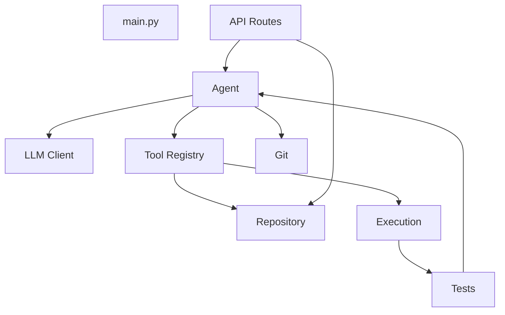

### Potential node types

```text
Entry Points
Modules
Services
Models
Routes
Repositories
Utilities
Tests
Configuration
```

### Potential relationships

```text
imports
calls
depends-on
tested-by
extends
implements
```

---

# 🔐 Security Model

CodeForge treats agent execution as privileged.

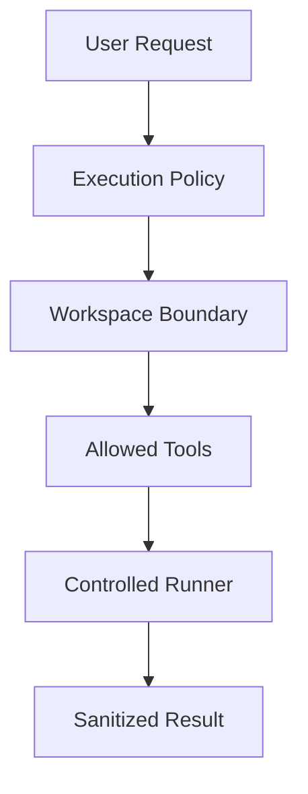

### Security principles

- Workspace-scoped file access
- Path traversal protection
- Absolute path restrictions
- `.git` protection
- File size limits
- Controlled command execution
- Execution timeouts
- Output limits
- Environment sanitization
- No unrestricted shell access
- No unrestricted network access
- Secrets kept outside source code
- API keys stored through environment variables
- GitHub credentials handled server-side
- Pull Requests preferred over direct main-branch modification

---

# 🧰 Technology Stack

## Frontend

```text
React
TypeScript
Vite
Framer Motion
Lucide Icons
CSS
```

## Backend

```text
Python
FastAPI
Pydantic
```

## AI

```text
NVIDIA Nemotron 3 Ultra 550B A55B
Nebius Token Factory
OpenAI-compatible API
```

## Development

```text
Git
GitHub
Pytest
Node.js
npm / pnpm
```

## Planned Infrastructure

```text
Supabase Auth
Supabase PostgreSQL
Supabase Realtime
GitHub API
```

---

# 🧠 NVIDIA + Nebius Architecture

CodeForge uses NVIDIA's Nemotron model through Nebius infrastructure.

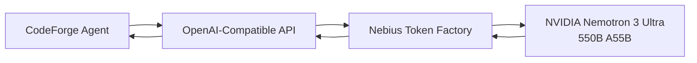

### Model configuration

```env
NEBIUS_MODEL=nvidia/nemotron-3-ultra-550b-a55b
NEBIUS_BASE_URL=https://api.tokenfactory.nebius.com/v1
```

> Never commit your actual `NEBIUS_API_KEY`.

---

# 📁 Project Structure

```text
codeforge-ai/
│
├── backend/
│   ├── app/
│   │   ├── core/
│   │   │   ├── main.py
│   │   │   └── config.py
│   │   │
│   │   ├── llm/
│   │   │   ├── __init__.py
│   │   │   ├── client.py
│   │   │   └── models.py
│   │   │
│   │   ├── agent/
│   │   │   ├── agent.py
│   │   │   ├── models.py
│   │   │   ├── prompts.py
│   │   │   └── state.py
│   │   │
│   │   ├── tools/
│   │   │   ├── __init__.py
│   │   │   ├── base.py
│   │   │   ├── registry.py
│   │   │   └── repository_tools.py
│   │   │
│   │   ├── repository/
│   │   │   ├── __init__.py
│   │   │   └── workspace.py
│   │   │
│   │   └── execution/
│   │       ├── models.py
│   │       ├── policy.py
│   │       ├── runner.py
│   │       └── sandbox.py
│   │
│   └── tests/
│       ├── test_agent.py
│       ├── test_llm.py
│       ├── test_workspace_security.py
│       └── fixtures/
│           └── sample_repo/
│
├── frontend/
│   ├── src/
│   │   ├── components/
│   │   │   ├── Agent/
│   │   │   ├── Code/
│   │   │   ├── Repository/
│   │   │   ├── Tests/
│   │   │   └── UI/
│   │   ├── hooks/
│   │   ├── lib/
│   │   ├── data/
│   │   ├── App.tsx
│   │   ├── index.css
│   │   └── main.tsx
│   └── package.json
│
├── supabase/
│   └── migrations/
│
├── docs/
│   ├── architecture/
│   ├── screenshots/
│   └── demo/
│
├── .env.example
├── .gitignore
├── LICENSE
└── README.md
```

> Keep this tree synchronized with the actual repository as development progresses.

---

# ⚙️ Installation

## Prerequisites

```text
Python 3.11+
Node.js 20+
Git
GitHub account
Nebius account/API key
```

---

# 📥 Clone Guide

```bash
git clone https://github.com/YOUR_USERNAME/codeforge-ai.git
cd codeforge-ai
```

Replace `YOUR_USERNAME` with the GitHub owner.

---

# 🐍 Backend Setup

```bash
cd backend
python3 -m venv venv
source venv/bin/activate
pip install -r requirements.txt
```

Windows:

```powershell
venv\Scripts\activate
pip install -r requirements.txt
```

---

# ⚛️ Frontend Setup

```bash
cd frontend
npm install
```

---

# 🔑 Environment Variables

Create:

```text
backend/.env
```

Example:

```env
NEBIUS_API_KEY=your_nebius_api_key
NEBIUS_BASE_URL=https://api.tokenfactory.nebius.com/v1
NEBIUS_MODEL=nvidia/nemotron-3-ultra-550b-a55b
```

Future Supabase variables:

```env
SUPABASE_URL=your_supabase_url
SUPABASE_ANON_KEY=your_supabase_anon_key
SUPABASE_SERVICE_ROLE_KEY=your_supabase_service_role_key
```

Frontend:

```env
VITE_SUPABASE_URL=your_supabase_url
VITE_SUPABASE_ANON_KEY=your_supabase_anon_key
```

### Never commit

```text
.env
API keys
Service role keys
GitHub access tokens
Passwords
Secrets
```

---

# ▶️ Running CodeForge

## Start Backend

From `backend/`:

```bash
uvicorn app.core.main:app --reload --port 8000
```

Backend:

```text
http://localhost:8000
```

Health endpoint:

```text
http://localhost:8000/health
```

---

## Start Frontend

From `frontend/`:

```bash
npm run dev
```

Frontend:

```text
http://localhost:5173
```

---

# 🧪 Testing

Run backend tests:

```bash
cd backend
pytest
```

The test suite covers areas such as:

```text
LLM integration
Agent behavior
Workspace security
Repository tools
Execution policy
```

Always use the actual current test result in documentation and demos.

---

# 🧑‍💻 Using CodeForge

## 1. Open CodeForge

```text
http://localhost:5173
```

## 2. Connect GitHub

Planned product flow:

```text
Sign In
   ↓
Connect GitHub
   ↓
Authorize CodeForge
```

## 3. Choose a Project

```text
┌─────────────────────────────┐
│       SELECT PROJECT        │
├─────────────────────────────┤
│                             │
│  Existing Repository        │
│  └── Select GitHub Repo     │
│                             │
│             OR              │
│                             │
│  New Project                │
│  └── Start From Scratch     │
│                             │
└─────────────────────────────┘
```

## 4. Describe the Task

Example:

```text
Add JWT authentication while preserving
the existing login flow.

Requirements:
- Add access and refresh tokens
- Protect authenticated routes
- Add tests
- Keep existing API behavior
- Do not expose secrets
```

## 5. Run Agent

```text
UNDERSTAND
     ↓
EXPLORE
     ↓
PLAN
     ↓
MODIFY
     ↓
TEST
     ↓
REPAIR
     ↓
VERIFY
```

## 6. Review Evidence

Example final result:

```text
VERIFIED ✓

Files changed:       7
Tests executed:      31
Tests passed:        31
Repair attempts:     1
LLM calls:           8
Tool calls:          14
Tokens used:         38.4K

Git branch:          feature/jwt-auth
Commit:              abc1234
Pull Request:        #42
```

> Only show metrics that actually came from the run.

---

# 🌿 Fork Guide

### 1. Fork the repository

Click **Fork** on GitHub.

### 2. Clone your fork

```bash
git clone https://github.com/YOUR_USERNAME/codeforge-ai.git
cd codeforge-ai
```

### 3. Add upstream

```bash
git remote add upstream https://github.com/ORIGINAL_OWNER/codeforge-ai.git
```

Check:

```bash
git remote -v
```

Expected:

```text
origin    → your fork
upstream  → original repository
```

### 4. Create a branch

```bash
git checkout -b feature/my-feature
```

### 5. Make changes

Run tests and builds.

### 6. Commit

```bash
git add .
git commit -m "feat: add my feature"
```

### 7. Push

```bash
git push -u origin feature/my-feature
```

### 8. Open a Pull Request

Create the PR from your fork to the original repository.

---

# 🔄 Development Workflow

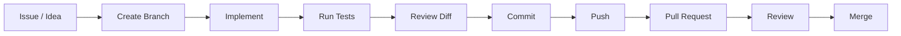

Recommended branches:

```text
feature/<name>
fix/<name>
refactor/<name>
docs/<name>
test/<name>
```

---

# 🧪 Agent State Machine

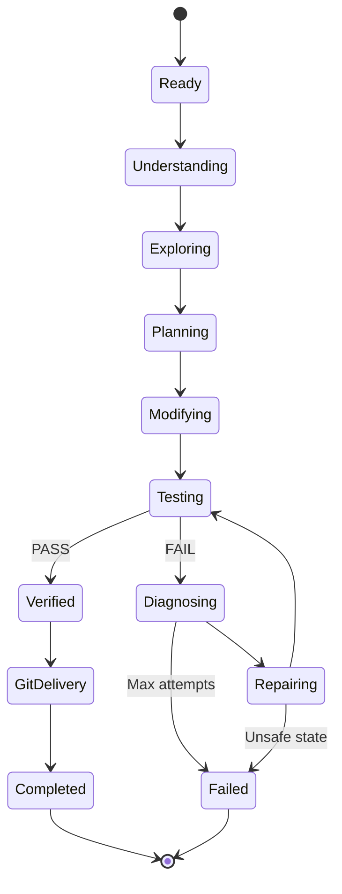

---

# 📡 Agent Events

Typical lifecycle:

```text
agent_started
      ↓
thinking
      ↓
tool_requested
      ↓
tool_completed
      ↓
analysis_updated
      ↓
tool_requested
      ↓
tool_completed
      ↓
analysis_updated
      ↓
agent_completed
```

Failure:

```text
agent_started
      ↓
thinking
      ↓
tool_requested
      ↓
tool_completed
      ↓
agent_failed
```

These events allow the frontend to render a live agent activity stream.

---

# 🖥️ Frontend State Model

```text
READY
  ↓
ANALYZING
  ↓
PLANNING
  ↓
MODIFYING
  ↓
TESTING
  ↓
REPAIRING
  ↓
VERIFYING
  ↓
COMPLETED
```

Failure can occur from any active stage:

```text
ANALYZING ───→ FAILED
PLANNING ─────→ FAILED
MODIFYING ────→ FAILED
TESTING ──────→ FAILED
REPAIRING ────→ FAILED
VERIFYING ────→ FAILED
```

---

# 🧩 API Surface

Current / planned API organization:

```text
/api/v1
│
├── /health
│
├── /llm
│   └── /generate
│
├── /agent
│   └── /analyze
│
├── /repositories
├── /projects
├── /runs
├── /tests
└── /github
```

> Keep this section synchronized with the actual FastAPI routes.

---

# 📦 Example Agent Request

```json
{
  "task": "Add JWT authentication while preserving the existing login flow.",
  "repository": "codeforge-demo"
}
```

Illustrative result:

```json
{
  "status": "completed",
  "summary": "Implemented JWT authentication.",
  "files_changed": [],
  "tests": {
    "passed": 31,
    "failed": 0
  },
  "repair_attempts": 1,
  "verified": true
}
```

> Example payloads are illustrative. Actual schemas should match the backend models.

---

# 🔭 Future Features

```text
                    CODEFORGE
                        │
        ┌───────────────┼────────────────┐
        │               │                │
      AGENT          INSIGHTS         PLATFORM
        │               │                │
        ├─ GitHub       ├─ Usage         ├─ Auth
        ├─ PRs          ├─ Tokens        ├─ Supabase
        ├─ Repair       ├─ Cost          ├─ Projects
        ├─ Verify       ├─ Efficiency    └─ Teams
        └─ Sandbox      └─ Prompt Lab
```

### Agent

- More repository tools
- Better context selection
- More execution environments
- Improved repair strategies
- Test-aware planning
- Safer autonomous execution
- Multi-language repository support

### GitHub

- Repository browsing
- Branch management
- Commit generation
- Pull Request creation
- PR review assistance
- PR comments
- Issue integration

### Intelligence

- Prompt Score
- Prompt Improvement
- Token estimation
- Actual token accounting
- Cost tracking
- Agent efficiency
- Repository architecture graph

### Platform

- Authentication
- Supabase persistence
- User projects
- Agent run history
- Realtime agent events
- Usage dashboard
- Team collaboration

---

# 🗺️ Long-Term Product Architecture

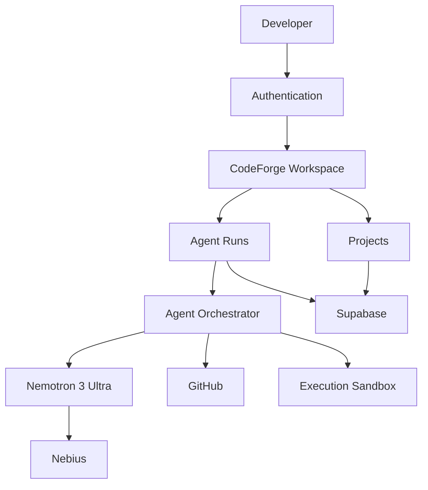

---

# 🎯 Hackathon Demo

The ideal CodeForge demo follows one complete engineering task.

## Demo Scenario

```text
Repository:
codeforge-demo

Task:

"Add JWT authentication while preserving
the existing login flow."
```

### Demo sequence

```text
01  Landing Page
        ↓
02  Sign In
        ↓
03  Connect GitHub
        ↓
04  Select Repository
        ↓
05  Submit Task
        ↓
06  Repository Exploration
        ↓
07  Implementation Plan
        ↓
08  Code Modification
        ↓
09  Tests Fail
        ↓
10  Autonomous Diagnosis
        ↓
11  Repair
        ↓
12  Tests Pass
        ↓
13  Verification
        ↓
14  Git Branch
        ↓
15  Commit
        ↓
16  Pull Request
        ↓
17  VERIFIED
```

---

# 🏆 The Killer Moment

The key CodeForge demo is not code generation.

It is autonomous recovery:

```text
TESTS
────────────────────────
27 passed
2 failed

        ↓

CODEFORGE
Diagnosing failure...

        ↓

Root cause identified.

        ↓

Repair attempt #1

        ↓

TESTS
────────────────────────
31 passed
0 failed

        ↓

VERIFICATION

✓ Implementation complete
✓ Tests passing
✓ Diff inspected
✓ No unresolved failures

        ↓

             VERIFIED ✓
```

---

# 🎨 Design Philosophy

CodeForge intentionally avoids the typical generic AI SaaS aesthetic.

```text
Avoid:
Purple
Neon
Huge gradients
Chatbot bubbles everywhere
Excessive glassmorphism
Unnecessary animation
```

Instead:

```text
Warm cream
Charcoal
Muted burgundy
Muted sage
Washed blue-gray

+

Editorial typography
Developer tooling density
Clear information hierarchy
Subtle motion
Readable code
```

The target feeling is:

```text
IDE
+
AI Agent
+
Engineering Dashboard
```

---

# ♿ Accessibility

CodeForge aims to support:

- Keyboard navigation
- Semantic HTML
- Visible focus states
- Accessible buttons
- Proper form labels
- Reduced-motion preferences
- Sufficient color contrast
- Screen-reader-friendly status messages
- Non-color-only status indicators

---

# 📈 Engineering Philosophy

```text
AI generation ≠ Software engineering
```

Software engineering requires:

```text
Understand
    +
Design
    +
Implement
    +
Test
    +
Debug
    +
Verify
    +
Deliver
```

CodeForge is designed around this complete lifecycle.

---

# 🤝 Contributing

Contributions are welcome.

### 1. Fork

Fork the repository from GitHub.

### 2. Clone

```bash
git clone https://github.com/YOUR_USERNAME/codeforge-ai.git
```

### 3. Create a branch

```bash
git checkout -b feature/my-feature
```

### 4. Make changes

Follow the existing architecture and coding conventions.

### 5. Test

```bash
pytest
```

and:

```bash
npm run build
```

### 6. Commit

```bash
git add .
git commit -m "feat: describe your change"
```

### 7. Push

```bash
git push -u origin feature/my-feature
```

### 8. Open a Pull Request

Include:

```text
What changed?
Why?
How was it tested?
Any known limitations?
```

---

# 🛡️ Security

If you discover a security vulnerability, do not publicly disclose sensitive details in an issue. Contact the repository maintainer privately.

Never commit:

```text
.env
API keys
GitHub tokens
Supabase service role keys
Private credentials
Passwords
```

---

# 📜 License

CodeForge AI is released under the **MIT License**.

See [`LICENSE`](LICENSE) for the full license text.

---

# ⚒️ CodeForge AI

```text
┌───────────────────────────────────────────────┐
│                                               │
│              CODEFORGE AI                     │
│                                               │
│      Doesn't just write code.                 │
│              It proves its work.              │
│                                               │
│     UNDERSTAND → BUILD → TEST → REPAIR       │
│                    ↓                          │
│                 VERIFY                        │
│                    ↓                          │
│                GITHUB PR                      │
│                                               │
└───────────────────────────────────────────────┘
```

**Built with React · TypeScript · FastAPI · Python · NVIDIA Nemotron · Nebius · GitHub**

---

## ⭐ If CodeForge helps you

Star the repository, open an issue, contribute an improvement, or share the project.

**Build with confidence. Verify with evidence.**
